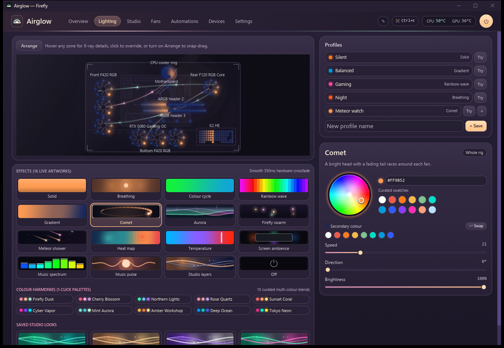

# Airglow 2.0

**Your lights, your fans, your kind of setup — rebuilt from the ground up in native Rust.**

Airglow 2.0 is a fast, lightweight, open-source RGB lighting, fan control, and hardware telemetry desktop app for Windows. Powered by **Iced 0.14** (pure GPU `wgpu` rendering, zero WebView2/Electron) and **Tauri's standalone OS crates** (`tray-icon` + `muda`), it launches in **~600–700 ms**, sips **~1% CPU** while animating 236 LEDs, and drops to **~0.23% CPU** in the system tray.


---

## Highlights

- **13 Interface Designs + Appearance Studio** — Flagship **Firefly** (velvet dusk-plum, bellflower meadow, glowing lantern moth), **Graphite**, **Paper** (daylight), **Midnight**, **Kiln**, **Spore**, **Amber CRT**, **ASCII**, **High Contrast**, and more — plus **Live Accent Overrides** (`#HEX` + curated swatches), **Saved Looks**, **Rig Stage Styles** (*Living / Architectural / Minimal*), and automatic **Windows 11 DWM native titlebar tinting**.
- **Living PC Case Stage** — Real-time visualization of your actual zones, spinning 7-blade fans scaled to live RPM, toggleable thermal airflow ribbons, AIO OLED CPU readout, Keychron / matrix keyboard lighting, hover zone X-Ray tooltips, and snap-to-grid **Arrange** mode.
- **16 Live-Animated Lighting Effects & 10 Colour Harmonies** — *Solid*, *Breathing*, *Colour cycle*, *Rainbow wave*, *Gradient*, *Comet*, *Aurora*, *Firefly swarm*, *Meteor shower*, *Heat map*, *Temperature*, *Screen ambience* (native Win32 GDI), *Music spectrum* & *Music pulse* (native WASAPI loopback FFT), *Studio layers*, and *Off* — with **350 ms smooth hardware crossfading** and an interactive jewel-halo **HSV Color Wheel**.
- **Studio Multi-Layer Composer** — Stack visual & audio-reactive layers with `Normal`, `Add`, `Screen`, and `Multiply` blend modes, 30-step Undo/Redo, live 24-band EQ, and **34 FPS real-rig previewing** on a dedicated non-blocking hardware thread.
- **Fan Curves & Cooling Telemetry** — Draggable Bezier/piecewise fan curves with configurable **acoustic hysteresis (`0–8 °C`)**, 20% safety floor, 90 °C emergency override, LibreHardwareMonitor motherboard/AIO channel control, and session recording.
- **Compact Companion Mini-Mode (`Ctrl+M`) & Command Palette (`Ctrl+K`)** — Shrink to a sleek `430×404` desktop companion widget or control every tab, profile, effect, design, Saved Look, fan preset, and Sleep timer straight from the keyboard.
- **Direct Hardware Control** — Native USB HID support for **NZXT HUE 2 / Control Hub** and **ASUS Aura**, **OpenRGB SDK** TCP integration, **LibreHardwareMonitor** live telemetry, RGB software conflict detection, and one-click migration from legacy Airglow configs.

| Lighting Atelier | Compact Mini-Mode (`Ctrl+M`) | Paper Light Design |
| :---: | :---: | :---: |
|  |  |  |

---

## Keyboard Shortcuts

| Shortcut | Action |
| --- | --- |
| `1` – `7` / `Ctrl+1` – `Ctrl+7` | Switch workspace tabs |
| `Ctrl+K` | Open Command Palette |
| `Ctrl+M` | Toggle Compact Companion Mini-Mode |
| `?` or `Ctrl+/` | Open Keyboard Shortcuts sheet |
| `Ctrl+Z` / `Ctrl+Y` | Studio Undo / Redo (30 steps) |
| `Esc` | Close active overlay |

---

## Workspace Architecture

```text
crates/
├── airglow-core/   # Headless hardware, sensor, lighting, fan & automation engine
│   └── src/
│       ├── config.rs       # 13 design palettes, AppearanceConfig, Saved Looks, atomic JSON storage
│       ├── devices.rs      # Native USB HID (NZXT HUE 2 / ASUS Aura) packet builders & scanner
│       ├── openrgb.rs      # OpenRGB SDK TCP client & zone/matrix mapping
│       ├── effects.rs      # 16 built-in effects, 10 Harmonies, Studio layer compositor & crossfader
│       ├── inputs.rs       # Native Win32 GDI Screen Ambience & WASAPI loopback audio FFT
│       ├── fans.rs         # Fan curve interpolation, hysteresis, safety floor & emergency override
│       ├── lhm_control.rs  # LibreHardwareMonitor fan duty write-back
│       ├── sensors.rs      # LHM JSON telemetry, sysinfo CPU/RAM/app-resource metrics & demo fallback
│       ├── automations.rs  # Time, app, temperature & idle trigger rules engine
│       ├── cooling.rs      # Thermal session recorder
│       ├── engine.rs       # Non-blocking hardware & animation controller loop
│       ├── migrate.rs      # Automatic legacy Airglow config migrator
│       └── system.rs       # Win11 DWM titlebar tinting, autostart, RGB conflict detection & diagnostics
└── airglow-ui/     # Native Iced 0.14 GPU desktop shell & system tray
    ├── assets/             # Bundled Firefly artworks (firefly.png, firefly-dusk.png)
    └── src/
        ├── main.rs         # Iced daemon lifecycle, shortcuts, DWM sync & tray bridge
        ├── theme.rs        # All 13 design token maps & custom widget styles
        ├── canvas_stage.rs # Living PC rig stage, spinning fans, airflow ribbons & X-Ray tooltips
        ├── canvas_curves.rs# Interactive draggable fan curves & cooling graphs
        ├── canvas_widgets.rs# Live telemetry curves, gauges, 16 effect artworks & 13 design previews
        ├── canvas_colorwheel.rs # Cached GPU HSV Color Wheel with ambient jewel halo
        ├── canvas_ambient.rs    # Firefly bokeh particles & 24-band audio visualizer
        ├── views*.rs       # Overview, Compact Mini-Mode, Lighting, Studio, Fans, Automations, Devices, Settings, Palette
        └── tray.rs         # Dynamic live-tinted Windows system tray (tray-icon + muda)
```

---

## Building from Source (Windows)

Requires **Rust 1.90+** (`rustup`) and the MSVC toolchain.

```powershell
# Run the full test suite
cargo test --workspace

# Build optimized standalone release binary (no console window)
cargo build --release -p airglow-ui
```

The standalone executable is written to `target/release/airglow-ui.exe` (rename or copy as `Airglow.exe`). Configuration is stored in `%APPDATA%\Airglow-rs\config.json`.

---

## License

MIT — see [LICENSE](LICENSE).
