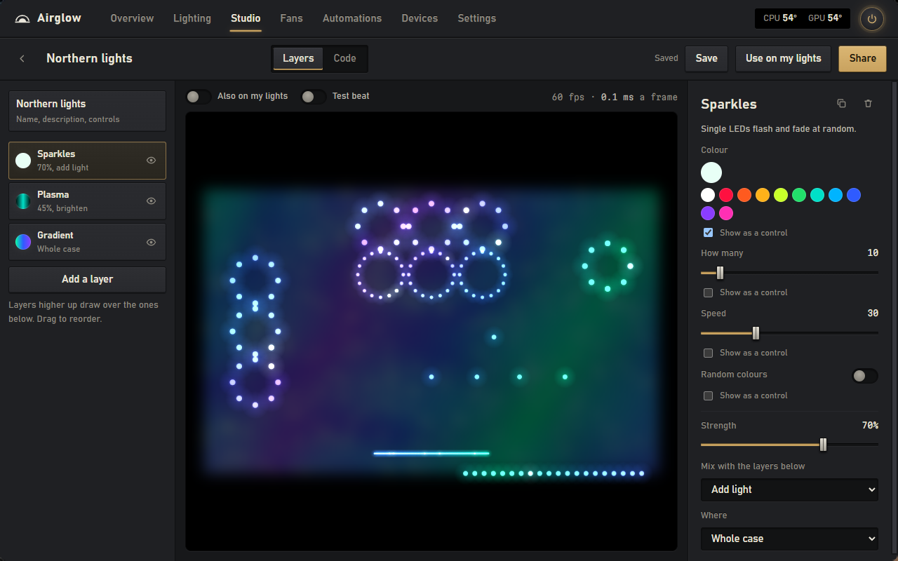
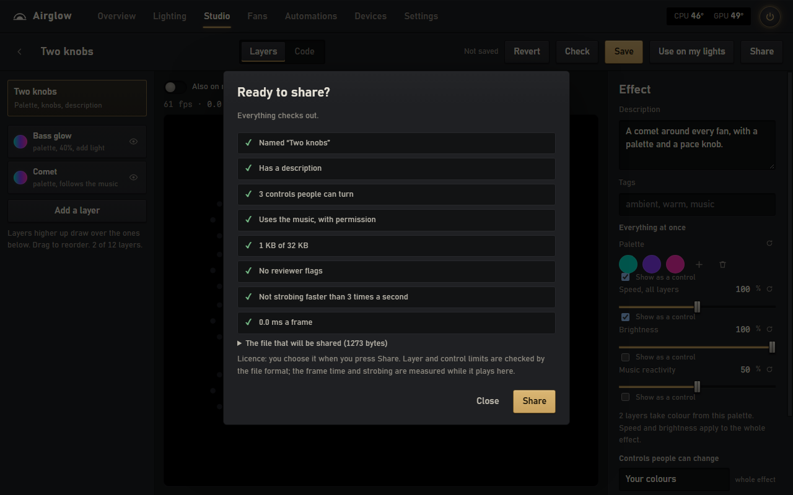
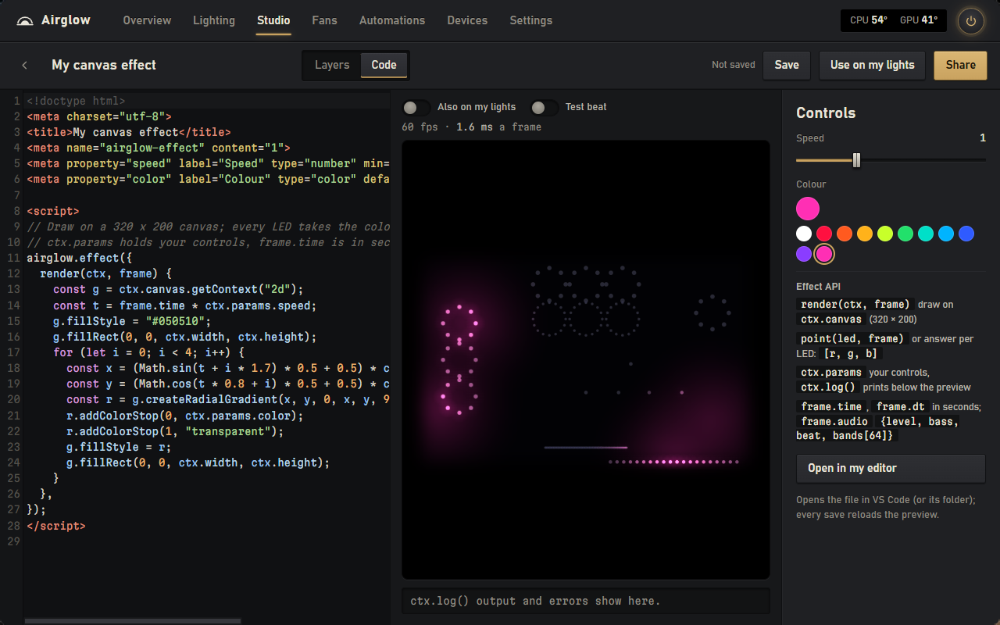
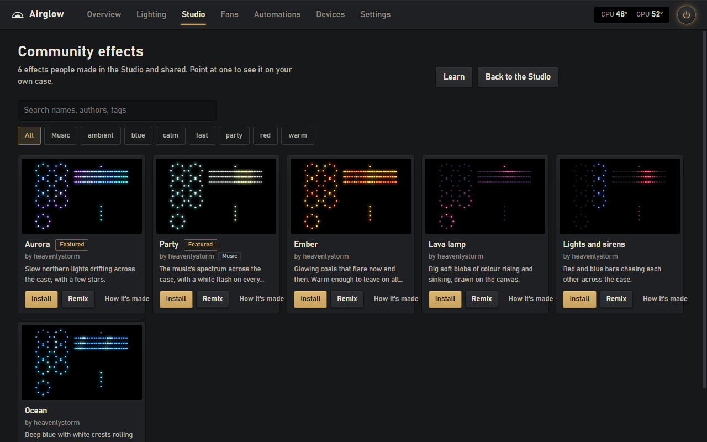

<p align="center"></p>

# Airglow

[](https://github.com/Heavenlystorm/airglow/releases/latest)
[](https://github.com/Heavenlystorm/airglow/releases)
[](https://github.com/Heavenlystorm/airglow/actions/workflows/tests.yml)

[](LICENSE)
[](https://www.reddit.com/r/AirglowRGB/)

Airglow runs the RGB lighting, the fans and the temperature readouts of a Windows PC from one app. If you've ended up
with NZXT CAM, Armoury Crate and an RGB program all running at once and fighting over the same LEDs, this replaces
them. It's free and open source, there's no account, and it doesn't collect anything.

**Show off your setup, ask questions and share effects on [r/AirglowRGB](https://www.reddit.com/r/AirglowRGB/).**


Settings, General also holds twelve **interface designs** (Graphite, ASCII, Paper, Amber CRT, High contrast, Neon,
Kiln, Lumen, Midnight, Spore, Rim and Darkroom), each with a live preview, and the electricity price behind the **Cost
per hour** tile, which turns the PC's current power draw into what an hour costs. Your lights keep their real colours
in every design.

<details>
<summary><b>What's new in 1.9</b></summary>

- The Studio works before any lights are set up: a labelled **sample case** stands in, and every template shows a
  real live still.
- One **palette** and **speed, brightness and music-reactivity** knobs for the whole effect, each exposable as a
  control. Controls keep their ids when a layer moves.
- **Music reaction on any layer**, plus **Comet** and **Chase** layers, built on each LED's place around its own fan
  or along its strip.
- **Undo/redo, autosave and Revert**, typed slider values and a reset, and a debug strip for code.
- **Share runs the check**: the reviewer list, strobing and frame time, and the exact file, before GitHub opens.
- Code effects declare controls with `airglow.params({...})`; `console.log` and clickable errors.
- **Six interface designs** (Graphite, ASCII, Paper, Amber CRT, High contrast and Neon) and a **Cost per hour** tile
  at your own tariff.

[Release notes](https://github.com/Heavenlystorm/airglow/releases/tag/v1.9.1) · [Changelog](CHANGELOG.md)
</details>

## Lighting
Airglow draws your fans and strips where they actually sit in the case and lights them with the colours the hardware
is showing right now. Setting that up takes a minute: each header blinks while you set it up, you pick the product
(NZXT accessories are recognised) or count its LEDs with a slider, and drag it into place.

Effects run across everything at once, so a rainbow really does sweep from the front fans to the back. There are ten
built in, from a plain colour to screen ambience and two that follow the music, and any single zone can have
its own. Profiles save a whole look, optionally with a fan curve, and you can share them or try other people's
before keeping them.


## The Studio
If none of the built-in effects is quite what you want, make your own. Pick a starting point or press **Surprise me**,
stack layers (gradients, plasma, waves, sparkles, a scanner, a comet around every fan, a chase, a pulse on the beat),
choose how each one mixes in and which part of the case it lights, and watch the result as you go. With no lights set
up yet it plays on a labelled sample case, so you can start before the hardware is configured. Turn on "Also on my
lights" and the real hardware follows along.

The palette, speed, brightness and music reactivity are one set of settings for the whole effect, so whoever installs
it can retune it in one place. Tick "Show as a control" under any setting, including the palette, and it appears in
their effect panel; a control stays with its own layer when you reorder the stack. Any layer can follow the music, and
undo/redo, autosave and Revert make experimenting cheap.



**Share** first shows the check a reviewer would run — the reviewer list, strobing and frame time, and the exact file
— then opens GitHub. Once the pull request is merged, everyone can find it in Studio, Community effects, see it on
their own case and install it; **How it's made** shows the layers and controls before installing, and **Learn** has the
rules and copyable recipes. Every effect, yours or someone else's, runs sandboxed: it can't reach the internet, your
files or the rest of Airglow. [docs/EFFECT-STUDIO.md](docs/EFFECT-STUDIO.md) has the format, and
[effects/README.md](effects/README.md) explains sharing.



If you'd rather write code, switch the editor to Code. An effect is a small HTML file with a script that draws on a
320 × 200 canvas, or simply answers "what colour is this LED right now?" — with `led.local`, `led.fan`, `led.area` and
`ctx.rig` when it needs to know where it is. Declare controls with `airglow.params({...})` next to the code, use
`console.log` and the clickable error line, and pause or slow the preview down to look at a frame. There are templates
to start from, [type declarations](docs/effect-api.d.ts) for editors, and you can edit in VS Code with the preview
reloading every time you save.





## Fans and automations
Fan curves are a line you drag into shape, following the processor, the graphics card, whichever is hotter, or the
coolant of a liquid cooler. Besides the fans on an NZXT hub, Airglow can drive the motherboard's own fan headers and
the pump and fans of many liquid coolers through LibreHardwareMonitor: each one stays on its BIOS or cooler curve
until you choose to have it follow the curve or hold a steady speed. Fans never go below 20 %, and at 90 °C they run
at full speed whatever the curve says. If the temperature readings stop, the fans go to a failsafe speed until they
come back, and when Airglow quits, the headers and coolers get their own curves back.

Automations are rules that read like sentences: "Between 23:00 and 07:00, turn the lights off", "When
Cyberpunk2077.exe is running, use Gaming". When a rule stops applying, you get your own settings back. Airglow also
turns the lights off while the PC sleeps (plenty of boards leave RGB on) and sets everything up again afterwards.

| Fans | Automations |
|---|---|
|  |  |

## Installing
1. Download `Airglow-stable-Setup.exe` from the [latest release](../../releases/latest) and run it. It installs for
   your Windows user only, so there's no admin prompt, and it starts with Windows. The installer isn't code-signed yet,
   so SmartScreen may say "Windows protected your PC". Choose More info, then Run anyway, or see
   [Is it safe?](#is-it-safe) first.
2. Close any other RGB software (SignalRGB, iCUE, NZXT CAM, Armoury Crate). Two programs driving the same LEDs makes
   them flicker. Airglow spots the usual ones and offers to close them.
3. Open Airglow. The welcome screen shows what it found. Temperatures and most RGB devices come from two other free
   programs, LibreHardwareMonitor and OpenRGB; if they're missing, the welcome screen offers **Set up automatically**,
   which downloads them from their official sources, checks each file against a known checksum and installs them.
   Windows asks for permission once.
4. Press **Set up lights** and tell Airglow what's plugged in where. It takes about a minute.

Already on 1.6 or newer? Airglow updates itself: it asks once whether to check automatically, and if you say no it
only looks when you press "Check for updates" in Settings, About. Coming from 1.5 or older, run the new installer; it
keeps your settings, profiles and helper programs.

You need Windows 10 (1809 or newer) or Windows 11. Windows 11 already has the WebView2 runtime Airglow uses; on
Windows 10 it usually comes with Edge. If your PC doesn't have it, the installer adds it, and if you start Airglow
without it (from the portable zip, say) it tells you where to get it.

<details>
<summary>Scoop, winget or the portable zip</summary>

Scoop (run `scoop update airglow` to update it):

```
scoop bucket add airglow https://github.com/Heavenlystorm/scoop-airglow
scoop install airglow
```

**winget:** a manifest is in review; once Microsoft merges it, `winget install Heavenlystorm.Airglow` works. Until
then, use the installer or Scoop.

The portable zip is on the [releases page](https://github.com/Heavenlystorm/airglow/releases); it needs the WebView2
runtime, which the installer would add for you.
</details>

<details>
<summary>Setting up the helper programs yourself, or motherboard fans</summary>

- For temperatures and power, install [LibreHardwareMonitor](https://github.com/LibreHardwareMonitor/LibreHardwareMonitor),
  run it and turn on Options, Remote Web Server, Run. Without it you still see memory, network, disk and processor
  load, but the fan curves have no temperature to follow, so the fans stay at the failsafe speed.
- Most RGB devices (RAM, graphics cards, keyboards, mice, strips, coolers) go through [OpenRGB](https://openrgb.org).
  Start it with its SDK server on (Settings, SDK Server, Start Server, or run it with `--server`) and they appear in
  Airglow's Devices tab.
- Motherboard fan headers and the pumps of supported coolers are driven through LibreHardwareMonitor too: pick them
  on the Fans tab. If you'd rather keep them in [FanControl](https://getfancontrol.com), Airglow switches its
  profiles when you switch profiles in Airglow.
</details>

## Supported hardware
| Connection | Devices |
|---|---|
| Directly over USB | NZXT Control Hub. ASUS Aura USB motherboard controller `0B05:19AF`. |
| Directly over USB, experimental | NZXT RGB & Fan Controller, Smart Device V2, HUE 2, HUE 2 Ambient and the HUE 2 lighting of NZXT N7 motherboards; ASUS Aura motherboard controllers `18F3`, `1939`, `1AA6`, `1BED`. They speak the same protocol as the tested ones but nobody has confirmed them with Airglow yet. If you own one, please [say how it went](CONTRIBUTING.md#reporting-a-problem). |
| Through OpenRGB | Everything OpenRGB supports. ARGB headers it splits into fans show up as fan rings, keyboards as a grid. |
| Fans and pumps through LibreHardwareMonitor | The motherboard's fan headers, and the pumps and fans of NZXT Kraken X3, Z3, 2023 and 2024 Elite and older Kraken X coolers, MSI CoreLiquid, Aquacomputer D5 Next and Aquastream XT, Arctic and Razer fan controllers and the NZXT Grid+. Everything LibreHardwareMonitor can control, except graphics card fans, which stay with the card. |
| Windows Dynamic Lighting, experimental | Keyboards, mice and accessories with HID LampArray support. Off by default (Settings, More devices), because Windows only lets Airglow light them while its window is in front. |
| Sensors | Everything LibreHardwareMonitor reports. Memory, network, disk and processor load work without it. |
| Motherboard fans | Directly through LibreHardwareMonitor (Fans tab), or through FanControl profiles. |

Controllers Airglow drives directly come from device plugins, one file per family in
[`airglow/plugins/`](airglow/plugins/). [CONTRIBUTING.md](CONTRIBUTING.md) explains how to add one.

## Troubleshooting
A device is missing or says "busy": another RGB program still has it open. Close it (check the tray too) and give it
a few seconds.

No temperatures: LibreHardwareMonitor isn't running, or its web server is off. Airglow looks for it at the address in
Settings, Sensors, which is `http://127.0.0.1:8085` unless you changed it. While it can't be reached, Airglow
tries again every 12 seconds.

OpenRGB devices don't show up: make sure OpenRGB's SDK server is running. Airglow tries again every 10 seconds.

A strip shows the wrong colours: change its colour order (RGB, GRB and so on) in Devices.

A Studio effect is dark: Airglow turns an effect off if it hangs or uses too much memory, and says so at the top of
the window with a Try again button. Music effects stay dark while nothing is playing; Test beat in the Studio shows
what they'd do.

For anything else, go to Settings, About, press **Save a report** and attach the zip to an issue. It has the logs and
what Airglow found, with your user name, PC name and device serial numbers taken out. Settings live in
`%APPDATA%\Airglow`, logs in its `logs` folder.

## Is it safe?
Airglow only listens on `127.0.0.1`, and every change has to carry a header that websites can't send, so a web page
can't touch your hardware. Studio effects run in a sandbox: all they can do is say what colour each LED should be.
[SECURITY.md](SECURITY.md) goes into more detail.

There's no telemetry. Airglow only goes online for the update check (on its own only if you said yes to that), the
community galleries while you have them open, and setting up the helper programs when you ask it to. The update check
and the galleries only talk to GitHub; the helper programs come from their own official sites.

If you let Airglow set up LibreHardwareMonitor, its web server only answers on this PC and needs a password Airglow
made up for it (kept in `%APPDATA%\Airglow\lhm-auth.json` and left out of diagnostics reports).

The installer isn't signed yet. Releases are built by GitHub Actions straight from this repository, never on
someone's PC, and you can always build it yourself (below) and compare.

## Building from source
```
pip install -r requirements-dev.txt
python -m unittest discover -s tests -t .     # no hardware needed
python run.py                                 # run it from source
python tools\dev_server.py --demo             # the UI on http://127.0.0.1:8790 with a pretend PC
.\build.ps1                                   # tests, then dist\Airglow\ and the installer in dist\releases\
```
The installer is made with Velopack's `vpk` (`dotnet tool install -g vpk --version 1.2.161`). Releases are built when
a version tag is pushed; [docs/RELEASING.md](docs/RELEASING.md) has the steps.

## How it's put together
- `airglow/devices.py`, `airglow/hw.py`: USB drivers for the NZXT and ASUS controllers and the device layer. The
  packet builders are plain functions, tested against captures from real hardware. Device plugins in
  `airglow/plugins/` decide which controllers get a driver.
- `airglow/openrgb.py`: a client for the OpenRGB SDK protocol (version 5, falling back to 3), written from the
  published protocol.
- `airglow/dynlight.py`: Windows Dynamic Lighting through `Windows.Devices.Lights`.
- `airglow/lighting/`: zone geometry, the built-in effects (numpy, about 30 frames a second), screen and audio
  capture that only run while an effect needs them, and the engine that sends each device its changed frames on its
  own thread. `studio.py` runs Studio effects for the real lights in a separate, sandboxed effect host process.
- `airglow/sensors.py`: every LibreHardwareMonitor sensor by its stable id, plus shortcuts like `auto/cpu_temp` that
  find the right sensor on any PC.
- `airglow/automation.py` and `airglow/controller.py`: the rules (the highest one that applies wins, separately for
  lights and fans), and the part that works out what should happen and runs the fan curves and the failsafe.
- `airglow/api.py`, `airglow/studioapi.py`: the local HTTP API and the event stream the window listens to.
- `airglow/fxformat.py`, `web/runtime/`: the Studio's effect format and the sandbox effects run in.
- `web/`: the interface, plain JavaScript modules with no framework and no build step.

The NZXT and ASUS packet formats follow what liquidctl and OpenRGB document for these controllers (credits in
[THIRD_PARTY_NOTICES.md](THIRD_PARTY_NOTICES.md)). Airglow is its own implementation and includes none of their code.

## Contributing
Bug reports and ideas are welcome on the [issues](https://github.com/Heavenlystorm/airglow/issues).
[CONTRIBUTING.md](CONTRIBUTING.md) has the setup, the test commands and the conventions; effects have their own guide
in [effects/README.md](effects/README.md), and each device family is one plugin in
[`airglow/plugins/`](airglow/plugins/). Security reports go through [SECURITY.md](SECURITY.md). The unit tests need no
hardware.

## Licence
MIT, see [LICENSE](LICENSE). Bundled components and their licences are listed in
[THIRD_PARTY_NOTICES.md](THIRD_PARTY_NOTICES.md).
