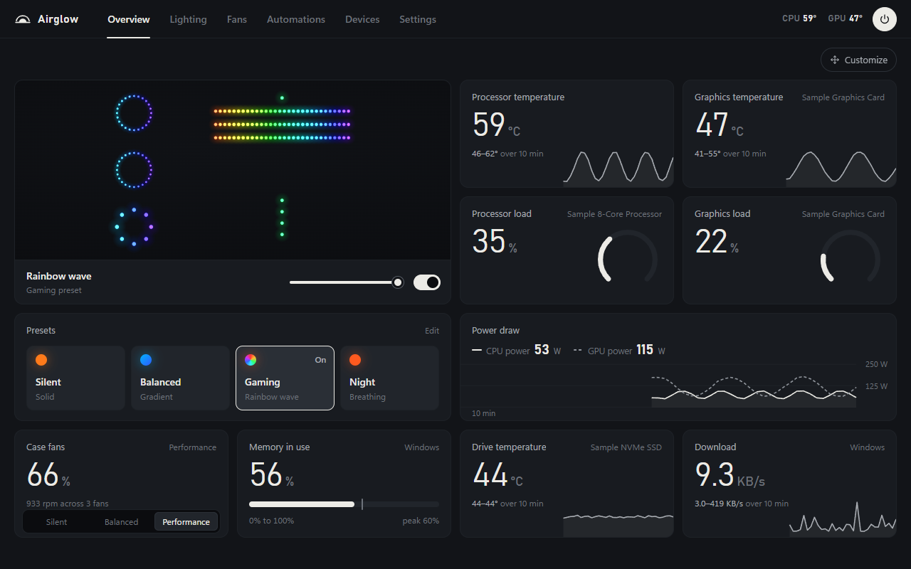
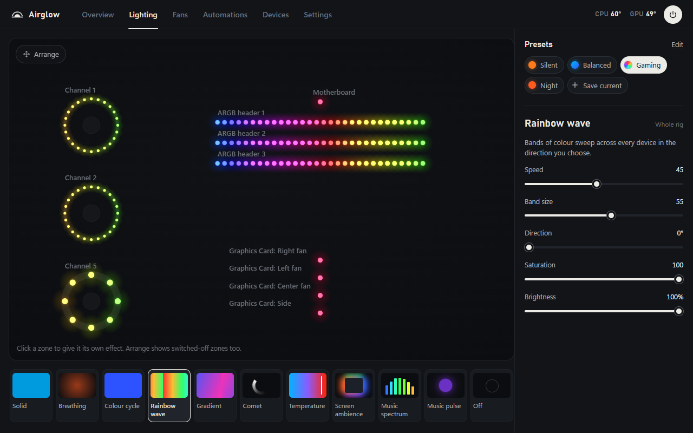
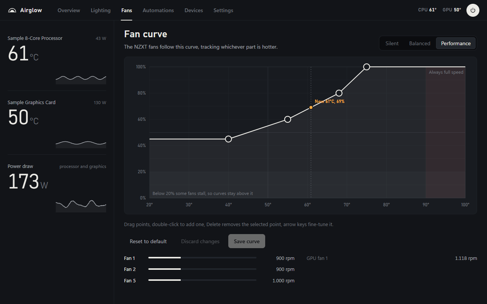
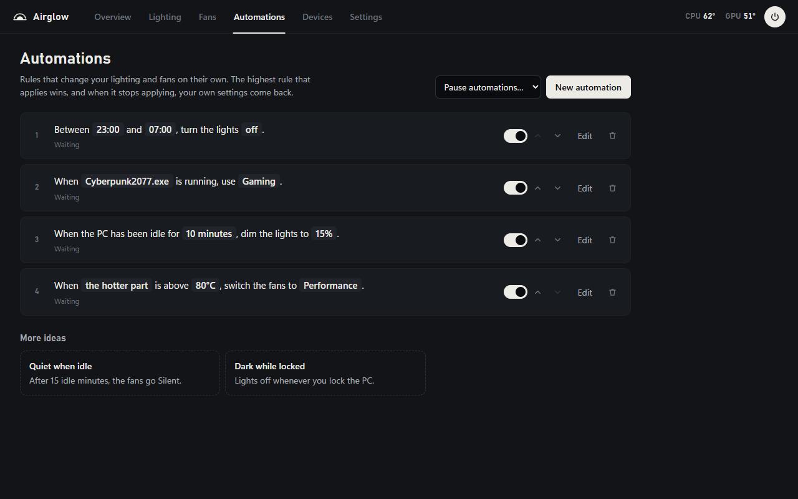

<p align="center"></p>

# Airglow

[](https://github.com/Heavenlystorm/airglow/releases/latest)
[](https://github.com/Heavenlystorm/airglow/releases)
[](https://github.com/Heavenlystorm/airglow/actions/workflows/tests.yml)

[](LICENSE)

Airglow controls the RGB lighting, fans and sensors of a Windows PC from one app, so NZXT CAM, Armoury Crate and
the rest don't all have to run at once. It's free and MIT-licensed. You don't need an account, and it doesn't send
anything anywhere.



What it does:
- Draws your fans and strips on screen where they sit in the case, lit with the colours the hardware is actually
  showing.
- Runs effects across every device at once: solid, breathing, colour cycle, rainbow, gradient, comet, temperature,
  screen ambience and two music effects. A single zone can also have an effect of its own.
- Lets you drag fan curves into shape. Fans never go below 20 %, and at 90 °C they run at full speed no matter what
  the curve says.
- Has automations that read like sentences, such as "Between 23:00 and 07:00, turn the lights off" or "When
  Cyberpunk2077.exe is running, use Gaming". When a rule stops applying, your normal settings come back.
- Shows any reading your PC has on an Overview of tiles you arrange yourself, with ten minutes of history.
- Turns the lights off while the PC sleeps (a lot of boards leave RGB on), and sets everything up again after sleep
  or when a device is unplugged and plugged back in.

| Lighting | Fans | Automations |
|---|---|---|
|  |  |  |

## Getting started
1. Download `Airglow-Setup-<version>.exe` from [Releases](../../releases) and run it. It installs for your Windows
   user only (no admin prompt) and can start with Windows. If SmartScreen says "Windows protected your PC", choose
   More info, Run anyway (see [Is it safe?](#is-it-safe)).
2. Close other RGB software (SignalRGB, iCUE, NZXT CAM, Armoury Crate, ...). Two programs driving the same LEDs
   makes them flicker. Airglow notices them and offers to close them.
3. Open Airglow. The welcome screen lists what it found. Temperatures and most RGB devices come from two other
   free programs, LibreHardwareMonitor and OpenRGB. Press **Set up automatically** and Airglow downloads them from
   their official sources, checks each file against a known checksum, installs them into
   `C:\Program Files\Airglow Tools` and has them start with Windows. Windows asks for permission once. You can
   remove them again in Settings, Helper programs.

   If you'd rather set them up yourself, or need motherboard fans:
   - For temperatures and power, install
     [LibreHardwareMonitor](https://github.com/LibreHardwareMonitor/LibreHardwareMonitor), run it and turn on
     Options, Remote Web Server, Run. Without it you still see memory, network, disk and processor load, but fan
     curves have no temperature to follow, so the fans stay at the failsafe speed.
   - Most RGB devices (RAM, graphics cards, keyboards, mice, strips, coolers) go through
     [OpenRGB](https://openrgb.org). Start it with its SDK server on (Settings, SDK Server, Start Server, or run it
     with `--server`) and they show up in Airglow's Devices tab.
   - Motherboard fans are handled by [FanControl](https://getfancontrol.com). Airglow switches its profiles when
     you change preset.
4. In Devices, check each zone's LED count and shape. If you're not sure, press Identify. The first LED blinks
   green, then a white dot walks through every LED in order.

Needs Windows 10 1809 or newer with the Edge WebView2 runtime (built into Windows 11). Airglow is Windows-only.

## Supported hardware
| Connection | Devices |
|---|---|
| Directly over USB | NZXT Control Hub. ASUS Aura USB motherboard controller `0B05:19AF`. |
| Directly over USB, experimental | NZXT RGB & Fan Controller, Smart Device V2, HUE 2 and HUE 2 Ambient; ASUS Aura motherboard controllers `18F3`, `1939`, `1AA6`, `1BED`. These speak the same protocol as the tested ones but haven't been confirmed with Airglow yet. If you own one, please [report how it went](CONTRIBUTING.md#reporting-a-problem). |
| Through OpenRGB | Everything OpenRGB supports. ARGB headers it splits into fans show as fan rings, keyboards as a grid. |
| Windows Dynamic Lighting, experimental | Keyboards, mice and accessories with HID LampArray support. Off by default (Settings, More devices): Windows only lets Airglow light them while its window is in front. |
| Sensors | Everything LibreHardwareMonitor reports. Memory, network, disk and processor load also work without it. |
| Motherboard fans | Through FanControl profiles. |

Directly supported controllers come from device plugins, one file per family in
[`airglow/plugins/`](airglow/plugins/). How to add one is in [CONTRIBUTING.md](CONTRIBUTING.md).

## Troubleshooting
If a device is missing or says "busy", another RGB program still has it open. Close that program (check the tray
too) and give it a few seconds.

If there are no temperatures, LibreHardwareMonitor isn't running or its web server is off. Airglow looks for it at
the address in Settings, Sensors, which is `http://localhost:8085` by default.

If OpenRGB devices don't show up, make sure OpenRGB's SDK server is running. Airglow tries again every 10 seconds.

If the colours on a strip look wrong, change its colour order (RGB, GRB and so on) in Devices.

For anything else, go to Settings, About and press **Save a report**, then open an issue and attach the zip. It has
the logs and what Airglow found, with your user name, PC name and device serial numbers taken out.

Settings are kept in `%APPDATA%\Airglow` and logs in its `logs` folder.

If you let Airglow set up LibreHardwareMonitor, its web server only answers on this PC and needs a password that
Airglow made up and keeps in `%APPDATA%\Airglow\lhm-auth.json`. Diagnostics reports leave that file out.

## Is it safe?
Airglow only listens on `127.0.0.1`, and every change has to carry a header that websites can't send, so a web page
can't touch your hardware. [SECURITY.md](SECURITY.md) has the details.

There's no telemetry and no account. The only time Airglow goes online is the update check, and that only happens
when you press the button.

The fans fail safe. If the sensors stop reporting, they run at the failsafe speed. At 90 °C they go to 100 %. When
you quit Airglow, it leaves them at the failsafe speed.

The installer isn't code-signed yet, which is why SmartScreen warns about it. If you'd rather not trust the
download, build it yourself from this repository (see below) and compare.

## Building from source
```
pip install -r requirements-dev.txt
python -m unittest discover -s tests -t .     # the tests need no hardware
python run.py                                 # run from source
python tools\dev_server.py --demo             # the UI on http://127.0.0.1:8790 with a simulated rig and sensors
.\build.ps1                                   # tests, then dist\Airglow\ and dist\Airglow-Setup-<version>.exe
```
Building the installer needs [Inno Setup 6](https://jrsoftware.org/isinfo.php). Releasing and signing:
[docs/RELEASING.md](docs/RELEASING.md).

## How it works
- `airglow/devices.py`, `airglow/hw.py`: USB drivers for the NZXT and ASUS controllers (packet builders are pure
  functions, tested against captures from real hardware) and the device layer. Which controllers get a driver comes
  from the device plugins in `airglow/plugins/`.
- `airglow/openrgb.py`: an independent client for the OpenRGB SDK protocol (version 5, falls back to 3).
- `airglow/dynlight.py`: Windows Dynamic Lighting devices through `Windows.Devices.Lights`.
- `airglow/lighting/`: zone geometry, effects (numpy, about 30 fps), screen and audio inputs that only run while an
  effect uses them, and the engine that streams changed frames to each device on its own thread.
- `airglow/sensors.py`: every LibreHardwareMonitor sensor by its stable id, plus `auto/...` shortcuts (such as
  `auto/cpu_temp`) that find the right sensor on any PC.
- `airglow/automation.py`: state-based rules; the highest active rule wins, separately for lights and fans.
- `airglow/controller.py`: works out what should happen from your settings, automations, sleep and lock, and runs
  the fan curves and the failsafe.
- `airglow/api.py`: the local HTTP API and a server-sent event stream for the UI.
- `web/`: the interface, plain JavaScript modules with no framework or build step.

The NZXT and ASUS packet formats follow what liquidctl and OpenRGB document for these controllers (credits in
[THIRD_PARTY_NOTICES.md](THIRD_PARTY_NOTICES.md)). Airglow is an independent implementation and includes none of
their code.

## Licence
MIT, see [LICENSE](LICENSE). Bundled components and their licences: [THIRD_PARTY_NOTICES.md](THIRD_PARTY_NOTICES.md).
