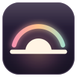
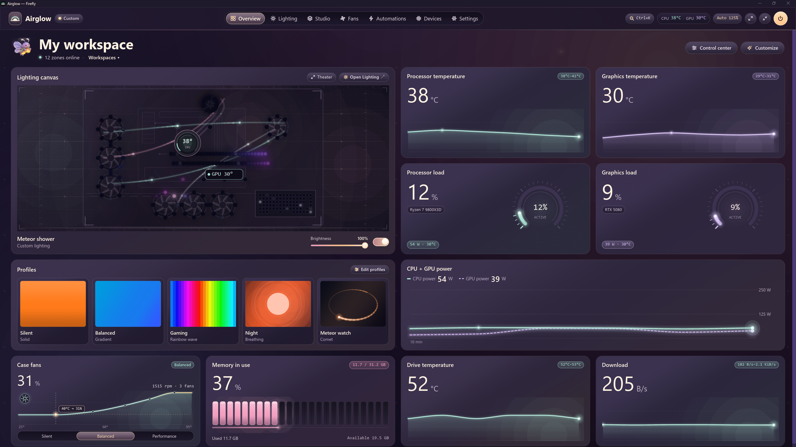
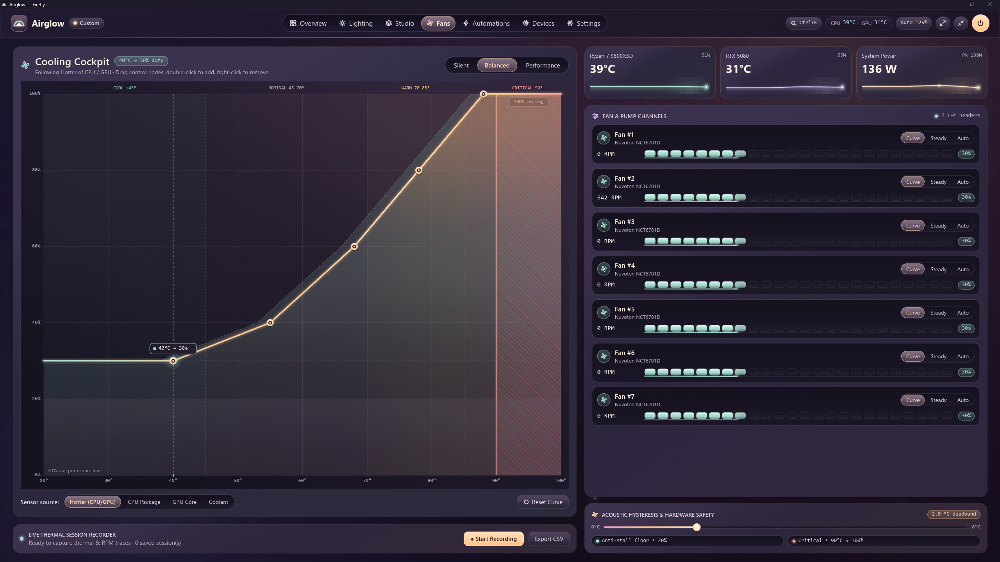
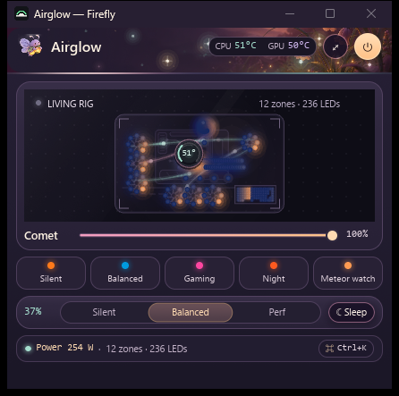
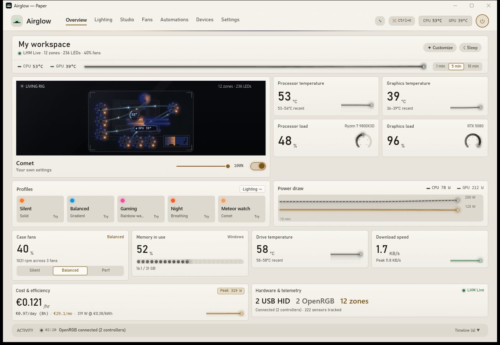

<div align="center">



<h1>Airglow</h1>

<p><strong>Your lights, your fans, your kind of setup — rebuilt from the ground up in native Rust.</strong></p>

<p>Open-source RGB lighting, fan curve control, and hardware telemetry for Windows, powered by <strong>Iced 0.14</strong> (<code>wgpu</code>) and Tauri's standalone OS tray crates (<code>tray-icon</code> + <code>muda</code>) — zero WebView2, zero Electron.</p>

<p>
  <a href="https://github.com/Heavenlystorm/airglow/releases/latest">
    
  </a>
  <a href="https://github.com/Heavenlystorm/airglow/actions/workflows/ci.yml">
    
  </a>
  <a href="https://github.com/Heavenlystorm/airglow/releases">
    
  </a>
  
  
  <a href="LICENSE">
    
  </a>
</p>

<p>
  <a href="https://github.com/Heavenlystorm/airglow/releases/latest"><strong>Download v2.2.1</strong></a>
  &nbsp;·&nbsp;
  <a href="https://airglowrgb.com">Website</a>
  &nbsp;·&nbsp;
  <a href="docs/RELEASE_NOTES_v2.2.1.md">v2.2.1 Release Notes</a>
  &nbsp;·&nbsp;
  <a href="#keyboard-shortcuts">Shortcuts</a>
  &nbsp;·&nbsp;
  <a href="#building-from-source-windows">Build from Source</a>
</p>

<br />



<em>Airglow 2.1.0 Overview in the flagship <strong>Firefly</strong> design — live 2D Bento dashboard with real-time rig stage, CPU/GPU tachometers, fan curve preview, and power telemetry.</em>

</div>

<br />

<div align="center">

| Cold Startup | Active Lighting | System Tray Idle | Portable Binary |
| :---: | :---: | :---: | :---: |
| **`~600–700 ms`** | **`~1% CPU`** *(236 LEDs @ 30 FPS)* | **`~0.23% CPU`** | **`~17 MB .exe`** *(zero WebView2)* |

</div>

---

## What's New in 2.2.1

> [!TIP]
> **Airglow 2.2.1 is out now.** Read the [v2.2.1 Hotfix Notes](docs/RELEASE_NOTES_v2.2.1.md) & [v2.2.0 Release Notes](docs/RELEASE_NOTES_v2.2.0.md), or grab `Airglow.exe` from [Latest Releases](https://github.com/Heavenlystorm/airglow/releases/latest).

- **In-App Updater & Restart Fix (`v2.2.1`)** — Fixed Windows `CreateProcessW` creation flags (`CREATE_NO_WINDOW | CREATE_NEW_PROCESS_GROUP`) so **Update & Restart** reliably launches the swap script, replaces `Airglow.exe`, and restarts automatically.

### Highlights from 2.2.0

- **Low-GPU Overview Mode & Widget Geometry Caching** — Toggle the Overview **Lighting canvas** between **Live** and **Static (low GPU)** right from the tile header (or Control Center / Settings / `Ctrl+K`), plus `canvas::Cache` on `UiIconCanvas` & Overview instruments and tab/focus-aware frame throttling (4 Hz when unfocused or on static tabs).
- **Halo-Free Overview Telemetry Tiles** — Cleaner, crisper Overview cards and instrument charts without radial washes or neon glow halos.
- **Hardened Tray Lifecycle & Single-Instance Focus** — Persists minimize-to-tray on close, supports `--background` silent autostart, and wakes/focuses the existing tray instance when re-launched instead of starting a duplicate process.
- **Richer Tray Menu, Window Persistence, Global Hotkeys & Native File Picker** — Live checkmarks + Brightness presets in the system tray menu, persisted window size/position/last tab across restarts, toggleable global hotkeys (`Ctrl+Alt+Shift+L / P / A`), and a native Windows **Browse…** picker for `.json` rig backups.

---

## Previously in 2.1.0

> Read the [v2.1.0 Release Notes](docs/RELEASE_NOTES_v2.1.0.md).

- **Auto-HiDPI Scaling & Crisp Zoom** — Automatically scales crisp vector UI at `1.25×` on 1440p/ultrawide displays, `1.50×` on 4K displays, and `1.0×` at 1440×900 — plus manual `Auto / 100% / 115% / 125% / 140%` presets and `Ctrl +` / `Ctrl -` / `Ctrl 0` zoom shortcuts.
- **Live 60 FPS 2D Bento Overview & Tile Workshop** — Grab any tile header (or anywhere in **`Customize`** mode) to drag-and-drop with snap-slot guides and automatic 2D reflow, resize corners smoothly (`1×1` up to `4×3`), manage multiple workspaces, and add Controls (*Desk Display*, *Lighting Lookbook*), built-in Sensors, or any of 222+ live LibreHardwareMonitor sensors.
- **Tactile Chrome, Frosted Dock & Full-Viewport Modes** — Centered frosted navigation dock with vector icons across all 7 tabs, milled-hardware controls, cached atmospheric `WindowBackdropCanvas`, Fullscreen (`F11`), and Theater Rig mode (`Shift+F11`) with floating HUD pills.
- **SHA-256 Verified GitHub Auto-Updater & Rig Backups** — Built-in **`Stable` | `Beta`** release checks against `Heavenlystorm/airglow` with `SHA256SUMS.txt` verification, 1-click download & restart-to-update, plus JSON Rig Backup Export/Import.

---

## Visual Tour

<table>
  <tr>
    <td width="50%" valign="top">
      <a href="docs/screenshots/lighting-atelier.png">
        
      </a>
      <p><strong>Lighting Atelier</strong> — Clickable Zone Filter bar, collision-free rig labels with leader lines, 16 live-animated effects, 10 Colour Harmonies, Saved Studio Looks, Quick Profiles &amp; 164px jewel-halo HSV Color Wheel.</p>
    </td>
    <td width="50%" valign="top">
      <a href="docs/screenshots/fans-cockpit.png">
        
      </a>
      <p><strong>Fans Cooling Cockpit</strong> — Draggable curve editor with thermal regime bands (<em>Cool / Nominal / Warm / Critical</em>), live crosshair pill, <code>0–8 °C</code> acoustic hysteresis, 7 illuminated LHM fan bars &amp; CSV thermal session recorder.</p>
    </td>
  </tr>
</table>

<table>
  <tr>
    <td width="36%" valign="top">
      <a href="docs/screenshots/compact-mini.png">
        
      </a>
      <p><strong>Compact Companion (<code>Ctrl+M</code>)</strong> — Sleek <code>430×404</code> widget with live rig preview, brightness slider, profile pills, fan presets, Sleep timer &amp; live wattage.</p>
    </td>
    <td width="64%" valign="top">
      <a href="docs/screenshots/paper-light.png">
        
      </a>
      <p><strong>13 Designs incl. Daylight Paper</strong> — Seamless Windows 11 DWM native titlebar tinting across dark, light, retro CRT, and high-contrast themes.</p>
    </td>
  </tr>
</table>

---

## Core Capabilities

<table>
  <tr>
    <td width="50%" valign="top">
      <h3>Lighting &amp; Studio Composer</h3>
      <ul>
        <li><strong>16 Live-Animated Effects</strong> — <em>Solid</em>, <em>Breathing</em>, <em>Colour cycle</em>, <em>Rainbow wave</em>, <em>Gradient</em>, <em>Comet</em>, <em>Aurora</em>, <em>Firefly swarm</em>, <em>Meteor shower</em>, <em>Heat map</em>, <em>Temperature</em>, <em>Screen ambience</em> (native Win32 GDI), <em>Music spectrum</em> &amp; <em>Music pulse</em> (native WASAPI loopback FFT), <em>Studio layers</em>, and <em>Off</em>.</li>
        <li><strong>10 Colour Harmonies &amp; 350 ms Crossfade</strong> — Smooth hardware crossfading paired with a cached GPU jewel-halo HSV Color Wheel, Secondary colour &amp; Swap.</li>
        <li><strong>Studio Multi-Layer Workbench</strong> — Stack visual &amp; audio-reactive layers with <code>Normal</code>, <code>Add</code>, <code>Screen</code>, and <code>Multiply</code> blend modes, 30-step Undo/Redo, live 24-band EQ, and <strong>34 FPS real-rig previewing</strong> on a dedicated non-blocking hardware thread.</li>
      </ul>
    </td>
    <td width="50%" valign="top">
      <h3>Cooling, Curves &amp; Telemetry</h3>
      <ul>
        <li><strong>Draggable Fan Curves</strong> — Piecewise curves with thermal regime bands, live hover crosshair probes, and configurable <strong>acoustic hysteresis (<code>0–8 °C</code>)</strong>.</li>
        <li><strong>Hardware Safety Guardrails</strong> — 20% anti-stall safety floor and automatic 90 °C emergency 100% override.</li>
        <li><strong>LibreHardwareMonitor Telemetry</strong> — Live motherboard/AIO fan channel control (<em>Curve / Steady / Auto</em>), 222+ searchable sensors, CPU/RAM/power graphs, and CSV thermal session recording.</li>
      </ul>
    </td>
  </tr>
  <tr>
    <td width="50%" valign="top">
      <h3>Appearance Studio &amp; Living Rig Stage</h3>
      <ul>
        <li><strong>13 Interface Designs</strong> — Flagship <em>Firefly</em> plus dark, daylight, phosphor CRT, and high-contrast themes.</li>
        <li><strong>Deep Personalisation</strong> — Live <code>#HEX</code> Accent Overrides + curated swatches, Saved Looks, Rig Stage Styles (<em>Living / Architectural / Minimal</em>), GPU Power Mode (<code>15 / 30 / 60 FPS</code>), and automatic <strong>Windows 11 DWM native titlebar tinting</strong>.</li>
        <li><strong>Living PC Case Stage</strong> — Spinning 7-blade fans scaled to live RPM, toggleable thermal airflow ribbons, AIO OLED CPU readout, matrix keyboard lighting, hover X-Ray tooltips, and snap-to-grid <strong>Arrange</strong> mode.</li>
      </ul>
    </td>
    <td width="50%" valign="top">
      <h3>Direct Hardware &amp; Smart Automations</h3>
      <ul>
        <li><strong>Native USB HID</strong> — Direct driverless support for <strong>NZXT HUE 2 / Control Hub</strong> and <strong>ASUS Aura</strong> USB controllers.</li>
        <li><strong>OpenRGB SDK &amp; Conflict Guard</strong> — Built-in OpenRGB TCP client, RGB software conflict detection, and dynamic live-tinted Windows system tray.</li>
        <li><strong>Smart Rules Engine &amp; Migration</strong> — Time, active app, temperature, and idle triggers with a Live Engine Evaluator, plus 1-click migration from Airglow 1.x configs.</li>
      </ul>
    </td>
  </tr>
</table>

<details>
<summary><strong>Browse all 13 built-in Interface Designs</strong></summary>

<br />

| Design | Aesthetic |
| --- | --- |
| **Firefly** *(default)* | Dusk plum, glowing lantern moth, apricot and mint |
| **Graphite** | Charcoal workshop, warm ivory and brass |
| **Paper** | Daylight paper and dark ink |
| **Midnight** | Deep navy and azure signal |
| **Kiln** | Near-black studio and ember orange |
| **Lumen** | Violet-black and blueprint brass |
| **Neon** | Deep indigo and magenta signal |
| **Spore** | Warm espresso and oyster pink |
| **Amber CRT** | Warm amber phosphor CRT |
| **ASCII** | P1 phosphor serial console |
| **Rim** | Warm black hairlines with corner ticks |
| **Darkroom** | Print-black with amber safelight |
| **High contrast** | Pure black, white and signal yellow |

</details>

---

## Quick Start (Windows)

1. **Download** `Airglow.exe` (standalone portable executable) or `Airglow-2.1.0-windows-x64-portable.zip` from the [Latest Release](https://github.com/Heavenlystorm/airglow/releases/latest).
2. **Verify (optional)** — Checksums for every release artifact are published in `SHA256SUMS.txt`.
3. **Launch** `Airglow.exe` directly — no installer or runtime required. Existing Airglow 1.x settings in `%APPDATA%\Airglow` migrate automatically into `%APPDATA%\Airglow-rs\config.json` on first run, and **Settings → Updates** keeps future releases 1-click away.

---

## Keyboard Shortcuts

| Shortcut | Action |
| --- | --- |
| `1` – `7` / `Ctrl+1` – `Ctrl+7` | Switch workspace tabs |
| `Ctrl +` / `Ctrl -` | Zoom UI scale up / down |
| `Ctrl + 0` | Reset UI scale to Auto (HiDPI) |
| `F11` | Toggle Fullscreen |
| `Shift + F11` | Toggle Theater Rig mode |
| `Ctrl + M` | Toggle Compact Companion Mini-Mode (`430×404`) |
| `Ctrl + K` | Open Command Palette |
| `?` / `Ctrl + /` | Open Keyboard Shortcuts sheet |
| `↑` / `↓` / `Enter` | Navigate &amp; run Command Palette item |
| `Ctrl + Z` / `Ctrl + Y` | Studio Undo / Redo (30 steps) |
| `Esc` | Close active overlay |

---

<details>
<summary><strong>Workspace Architecture (2-crate Rust workspace)</strong></summary>

<br />

```text
crates/
├── airglow-core/   # Headless hardware, sensor, lighting, fan & automation engine
│   └── src/
│       ├── lib.rs          # Core crate exports & shared types
│       ├── config.rs       # 13 design palettes, AppearanceConfig, Saved Looks, atomic JSON storage
│       ├── devices.rs      # Native USB HID (NZXT HUE 2 / ASUS Aura) packet builders & scanner
│       ├── openrgb.rs      # OpenRGB SDK TCP client & zone/matrix mapping
│       ├── geometry.rs     # 1.6 × 1.0 PC case zone layouts (Fans, Strip, Matrix)
│       ├── effects.rs      # 16 built-in effects, 10 Harmonies, Studio layer compositor & crossfader
│       ├── inputs.rs       # Native Win32 GDI Screen Ambience & WASAPI loopback audio FFT
│       ├── fans.rs         # Fan curve interpolation, hysteresis, safety floor & emergency override
│       ├── lhm_control.rs  # LibreHardwareMonitor fan duty write-back
│       ├── sensors.rs      # LHM JSON telemetry, sysinfo CPU/RAM/app-resource metrics & demo fallback
│       ├── automations.rs  # Time, app, temperature & idle trigger rules engine
│       ├── cooling.rs      # Thermal session recorder
│       ├── engine.rs       # Non-blocking hardware & animation controller loop
│       ├── migrate.rs      # Automatic legacy Airglow config migrator
│       ├── updates.rs      # GitHub Releases auto-updater with SHA-256 verification & self-swap
│       └── system.rs       # Win11 DWM titlebar tinting, autostart, RGB conflict detection & diagnostics
└── airglow-ui/     # Native Iced 0.14 GPU desktop shell & system tray
    ├── assets/             # Bundled Firefly artworks (firefly.png, firefly-dusk.png)
    └── src/
        ├── main.rs             # Iced daemon lifecycle, HiDPI scaling, shortcuts, DWM sync & tray bridge
        ├── brand.rs            # Procedural brand mark & dynamic live-tinted tray icon generator
        ├── theme.rs            # All 13 design token maps & milled-hardware widget styles
        ├── bento_grid.rs       # Custom 60 FPS 2D Bento widget with drag-and-drop & corner resize
        ├── canvas_stage.rs     # Living PC rig stage, spinning fans, airflow ribbons & X-Ray tooltips
        ├── canvas_curves.rs    # Interactive draggable fan curves & cooling graphs
        ├── canvas_widgets.rs   # Live telemetry curves, gauges, 16 effect artworks & 13 design previews
        ├── canvas_colorwheel.rs# Cached GPU HSV Color Wheel with ambient jewel halo
        ├── canvas_ambient.rs   # Firefly bokeh particles, WindowBackdropCanvas & 24-band EQ visualizer
        ├── views.rs            # Overview Bento dashboard, Tile Catalog & Workspace switcher
        ├── views_lighting.rs   # Lighting Atelier, Studio workbench, Fans Cooling Cockpit & Theater Rig
        ├── views_system.rs     # Automations, Devices, Sensor Explorer & Settings (incl. Auto-Updater)
        ├── views_palette.rs    # Command Palette (Ctrl+K), Keyboard Shortcuts sheet & Compact Mini-Mode
        └── tray.rs             # Dynamic live-tinted Windows system tray (tray-icon + muda)
```

</details>

---

## Building from Source (Windows)

Requires **Rust 1.90+** (Edition 2024 via `rustup`) and the MSVC toolchain.

```powershell
# Run the full test suite
cargo test --workspace

# Build optimized standalone release binary (no console window)
cargo build --release -p airglow-ui
```

The standalone executable is written to `target/release/airglow-ui.exe` (rename or copy as `Airglow.exe`). Configuration is stored in `%APPDATA%\Airglow-rs\config.json`.

---

## License

MIT — see [LICENSE](LICENSE).

<div align="center">
  <br />
  <sub>
    <a href="https://airglowrgb.com">airglowrgb.com</a>
    &nbsp;·&nbsp;
    <a href="https://github.com/Heavenlystorm/airglow/releases">Releases</a>
    &nbsp;·&nbsp;
    <a href="docs/RELEASE_NOTES_v2.1.0.md">v2.1.0 Release Notes</a>
    &nbsp;·&nbsp;
    <a href="docs/RELEASE_NOTES_v2.0.0.md">v2.0.0 Release Notes</a>
    &nbsp;·&nbsp;
    <a href="LICENSE">MIT License</a>
  </sub>
</div>
