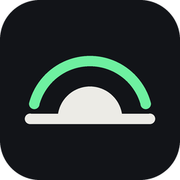
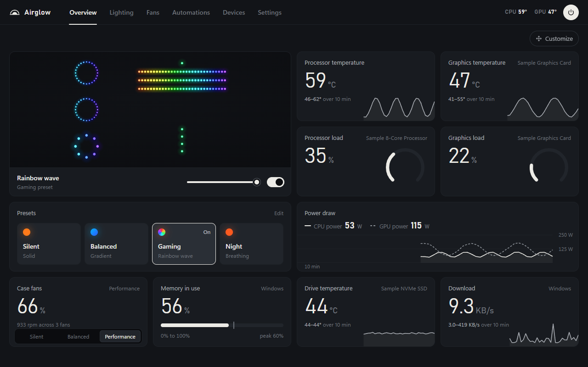
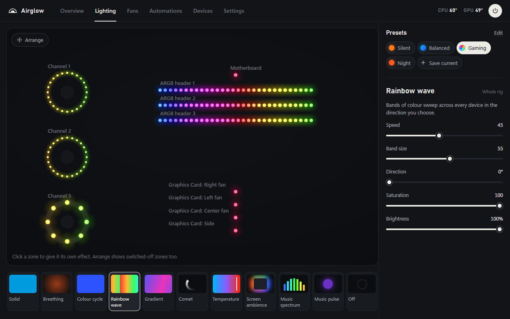
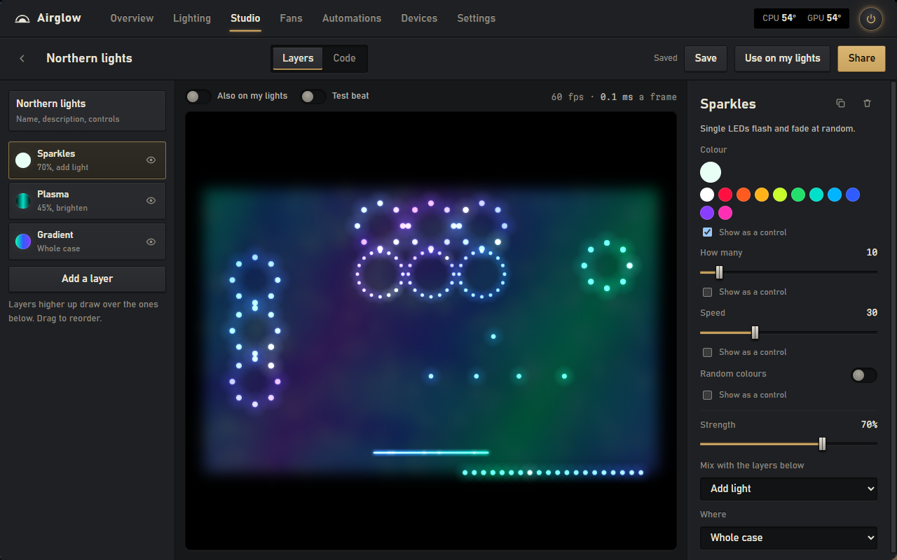
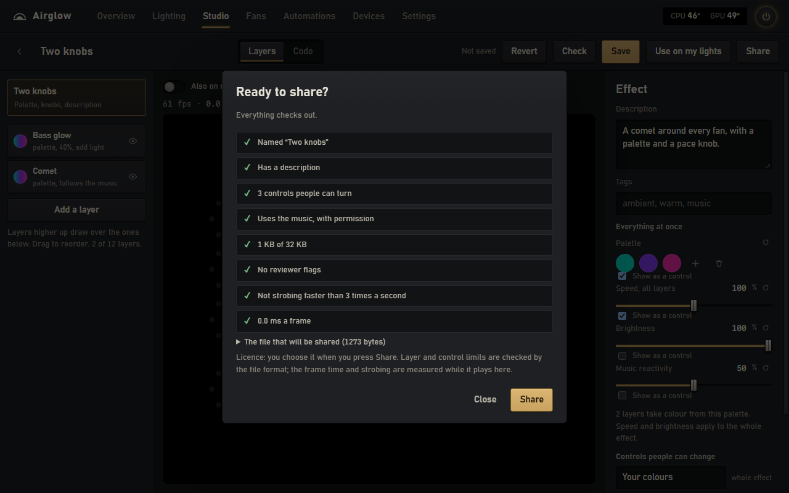
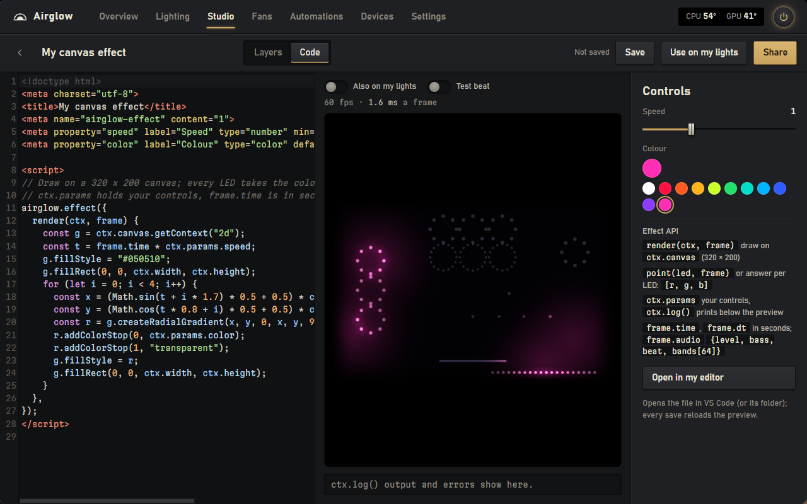
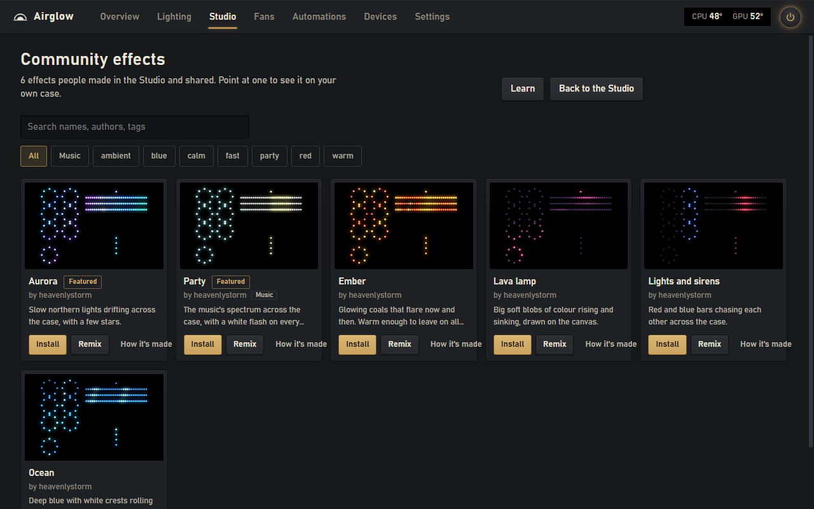
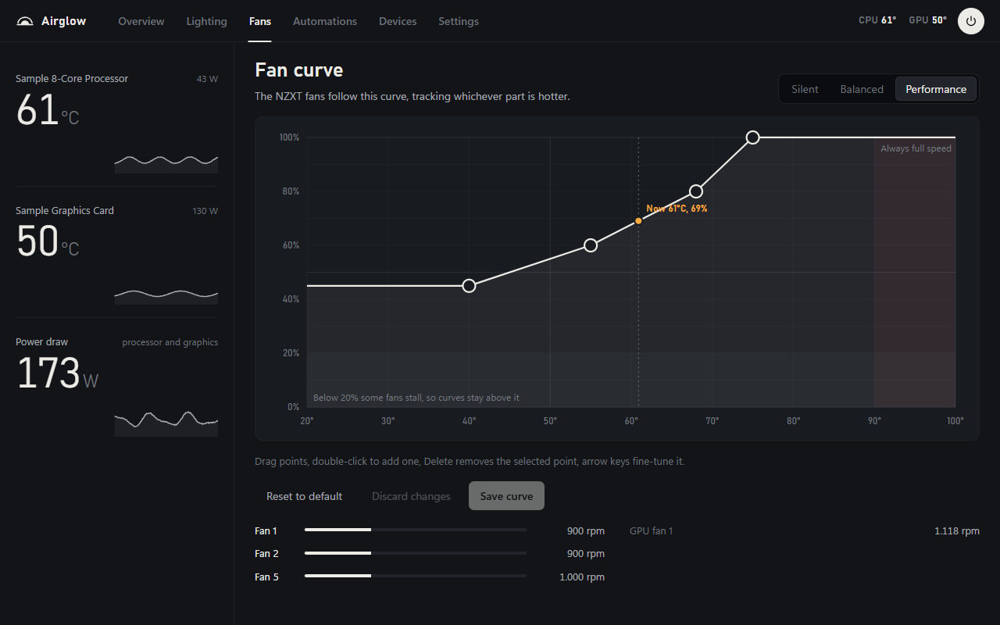
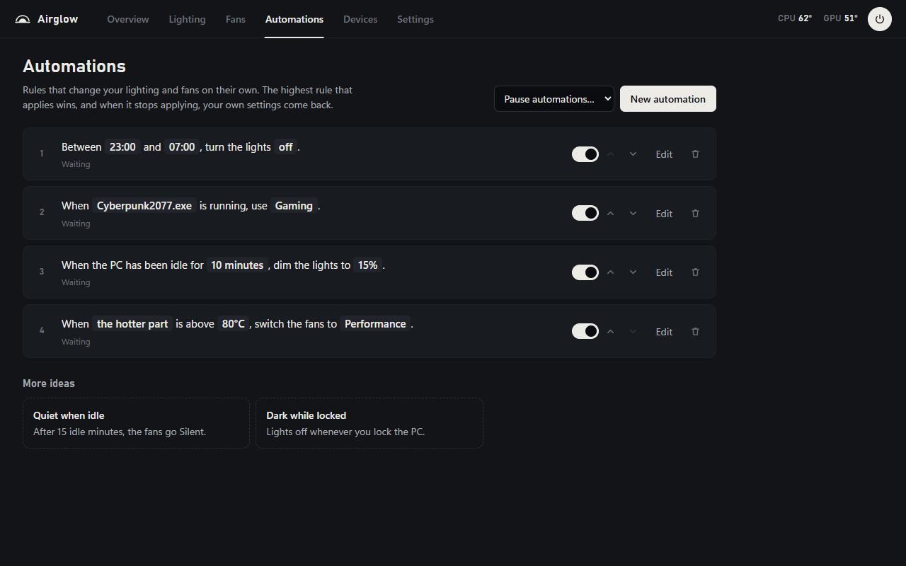

<p align="center"></p>

# Airglow

[](https://github.com/Heavenlystorm/airglow/releases/latest)
[](https://github.com/Heavenlystorm/airglow/releases)
[](https://github.com/Heavenlystorm/airglow/actions/workflows/tests.yml)

[](LICENSE)
[](https://www.reddit.com/r/AirglowRGB/)

**Your lights, your fans, your kind of setup.**

Hey, welcome! Airglow is a free, open-source Windows app for bringing RGB lighting, fan control and PC readings
together. If you've ever spent longer picking a colour than picking a wallpaper, you're in good company. If you just
want your lights to behave and your PC to stay cool, you're welcome here too.

**[Download Airglow](https://github.com/Heavenlystorm/airglow/releases/latest)** ·
[Visit the website](https://airglowrgb.com) ·
[Check your hardware](#supported-hardware) ·
[Say hello on Reddit](https://www.reddit.com/r/AirglowRGB/)



Here's what you can do:

- **Make it yours.** Set up the lights in your case, try the built-in effects, and save a look for every mood.
- **Play in the Studio.** Make an effect from layers, follow the music, or press **Surprise me** and see what happens.
  You can even try it on a sample case before setting up your lights.
- **Keep an eye on things.** See temperatures, load, power and fans together, with twelve interface designs to choose
  from. Your lights keep their real colours in every design.
- **Set it and get on with your day.** Shape a fan curve or make an automation for game time, quiet time or bedtime.

No account and no telemetry. Just a little more room to make your setup feel like yours.

Made something you like? We'd love to see it. Share your setup, ask a question or show off an effect on
[r/AirglowRGB](https://www.reddit.com/r/AirglowRGB/) or in
[GitHub Discussions](https://github.com/Heavenlystorm/airglow/discussions).

**A quick heads-up:** the Windows installer isn't signed yet, so Windows may show a warning. You can read
[why and how Airglow works](#is-it-safe) before deciding whether to install it.

## Installing

Ready to give it a try? You'll need Windows 10 (1809 or newer) or Windows 11.

1. Download `Airglow-stable-Setup.exe` from the [latest release](https://github.com/Heavenlystorm/airglow/releases/latest) and run it. It installs for
   your Windows user and starts with Windows. The installer isn't signed yet, so SmartScreen may show a warning.
   Read [Is it safe?](#is-it-safe) if you'd like more detail before you continue.
2. Close other RGB software, such as SignalRGB, iCUE, NZXT CAM or Armoury Crate. Two programs trying to drive the
   same LEDs can make them flicker. Airglow spots the usual ones and offers to close them.
3. Open Airglow and see what it found. Temperatures and most RGB devices come from two other free programs,
   LibreHardwareMonitor and OpenRGB. If they're missing, the welcome screen offers **Set up automatically**: it
   downloads them from their official sources, checks each file against a known checksum and installs them. Windows
   asks for permission once.
4. Press **Set up lights** and tell Airglow what's plugged in where. Then make yourself a nice colour (or several).

Already using Airglow 1.6 or newer? It asks whether to check for updates automatically. If you say no, it only checks
when you ask in Settings, About. Coming from 1.5 or older? Run the new installer; it keeps your settings, profiles and
helper programs. See the [release notes](https://github.com/Heavenlystorm/airglow/releases) or [changelog](CHANGELOG.md) for what's changed.

Windows 11 already has the WebView2 runtime Airglow uses, and Windows 10 usually gets it with Edge. If it's missing,
the installer adds it. If you start Airglow without it, for example from the portable zip, the app tells you where to
get it.

<details>
<summary>Scoop, winget or the portable zip</summary>

Scoop (run `scoop update airglow` to update it):

```
scoop bucket add airglow https://github.com/Heavenlystorm/scoop-airglow
scoop install airglow
```

**winget:** a manifest is in review; once Microsoft merges it, `winget install Heavenlystorm.Airglow` works. Until
then, use the installer or Scoop.

The portable zip is on the [releases page](https://github.com/Heavenlystorm/airglow/releases); it needs the WebView2
runtime, which the installer would add for you.
</details>

<details>
<summary>Setting up the helper programs yourself, or motherboard fans</summary>

- For temperatures and power, install [LibreHardwareMonitor](https://github.com/LibreHardwareMonitor/LibreHardwareMonitor),
  run it and turn on Options, Remote Web Server, Run. Without it you still see memory, network, disk and processor
  load, but the fan curves have no temperature to follow, so the fans stay at the failsafe speed.
- Most RGB devices (RAM, graphics cards, keyboards, mice, strips, coolers) go through [OpenRGB](https://openrgb.org).
  Start it with its SDK server on (Settings, SDK Server, Start Server, or run it with `--server`) and they appear in
  Airglow's Devices tab.
- Motherboard fan headers and the pumps of supported coolers are driven through LibreHardwareMonitor too: pick them
  on the Fans tab. If you'd rather keep them in [FanControl](https://getfancontrol.com), Airglow switches its
  profiles when you switch profiles in Airglow.
</details>

## Lighting

Make your case feel like yours. Airglow shows your fans and strips where they actually sit, with the colours your
hardware is showing right now. During setup, each header blinks so you can tell it apart; pick the product (NZXT
accessories are recognised) or count its LEDs with a slider, then drag it into place.

Choose from ten built-in effects, from a simple solid colour to screen ambience and music-reactive looks. Effects can
move across your whole case, or you can give a single zone its own look. Save the ones you love as profiles, optionally
with a fan curve, and share them or try someone else's before keeping them.



## The Studio

This is the fun bit if you like to tinker. Start with a template, press **Surprise me**, or build something of your
own by stacking layers: gradients, plasma, waves, sparkles, scanners, comets, chases and beat-driven pulses. Mix them
together, choose which part of the case they light, and watch as you go.

Don't have your lights set up yet? There's a sample case to play with. When you're ready, turn on **Also on my
lights** to see your creation on the real hardware.

The palette, speed, brightness and music reactivity are shared across an effect, so anyone who installs it can make
it their own. You can expose individual settings as controls, including the palette; controls stay with their layers
when you reorder them. Any layer can follow music, and undo/redo, autosave and Revert give you room to experiment.



Made something you like? **Share** shows the checks a reviewer would run, including strobing, frame time and the
exact file, before opening GitHub. Once its pull request is merged, others can find it under Studio, Community effects,
preview it on their own case and install it. **How it's made** shows the layers and controls, and **Learn** has rules
and recipes if you're looking for a starting point. Effects run in a sandbox; see
[docs/EFFECT-STUDIO.md](docs/EFFECT-STUDIO.md) for the format and [effects/README.md](effects/README.md) for sharing.



Prefer writing code? Switch the editor to Code. An effect is a small HTML file with a script that draws on a
320 × 200 canvas, or answers “what colour is this LED right now?” You can use `led.local`, `led.fan`, `led.area` and
`ctx.rig` to work with the case layout, declare controls with `airglow.params({...})`, and use `console.log` and
clickable errors while you work. Pause or slow the preview to inspect a frame, start from a template, or edit in
VS Code and watch the preview reload when you save. There are [type declarations](docs/effect-api.d.ts) for editors,
too.





## Fans and automations

Your setup can be quiet when you're working and ready for more when you need it. Draw a fan curve using the
processor, graphics card, whichever is hotter, or a liquid cooler's coolant temperature. Alongside fans on an NZXT
hub, Airglow can use LibreHardwareMonitor to control supported motherboard fan headers and cooler pumps and fans.
After setup, detected spinning fans automatically follow Airglow's curve. Pumps and headers without an RPM reading
need an explicit choice. Choose BIOS / device to keep a channel with its own controller; that choice is remembered.

For the fans Airglow controls, curves never go below 20%, and at 90 °C they run at full speed regardless of the
curve. If temperature readings stop, a failsafe speed takes over until they return. When Airglow quits, the headers
and coolers get their own curves back.

Automations read like little instructions: “Between 23:00 and 07:00, turn the lights off” or “When
Cyberpunk2077.exe is running, use Gaming.” When a rule stops applying, your own settings come back. Airglow also
turns the lights off while the PC sleeps and sets everything up again afterwards.

| Fans | Automations |
|---|---|
|  |  |

## Supported hardware

Every PC is a little different. Here's where Airglow connects directly, where helper programs come in, and which
devices still need a real-world try. If you test an experimental controller, we'd love to hear how it went.

| Connection | Devices |
|---|---|
| Directly over USB | NZXT Control Hub. ASUS Aura USB motherboard controller `0B05:19AF`. |
| Directly over USB, experimental | NZXT RGB & Fan Controller, Smart Device V2, HUE 2, HUE 2 Ambient and the HUE 2 lighting of NZXT N7 motherboards; ASUS Aura motherboard controllers `18F3`, `1939`, `1AA6`, `1BED`. They speak the same protocol as the tested ones but nobody has confirmed them with Airglow yet. If you own one, please [say how it went](CONTRIBUTING.md#reporting-a-problem). |
| Through OpenRGB | Everything OpenRGB supports. ARGB headers it splits into fans show up as fan rings, keyboards as a grid. |
| Fans and pumps through LibreHardwareMonitor | The motherboard's fan headers, and the pumps and fans of NZXT Kraken X3, Z3, 2023 and 2024 Elite and older Kraken X coolers, MSI CoreLiquid, Aquacomputer D5 Next and Aquastream XT, Arctic and Razer fan controllers and the NZXT Grid+. Everything LibreHardwareMonitor can control, except graphics card fans, which stay with the card. |
| Windows Dynamic Lighting, experimental | Keyboards, mice and accessories with HID LampArray support. Off by default (Settings, More devices), because Windows only lets Airglow light them while its window is in front. |
| Sensors | Everything LibreHardwareMonitor reports. Memory, network, disk and processor load work without it. |
| Motherboard fans | Directly through LibreHardwareMonitor (Fans tab), or through FanControl profiles. |

Controllers Airglow drives directly come from device plugins, one file per family in
[`airglow/plugins/`](airglow/plugins/). [CONTRIBUTING.md](CONTRIBUTING.md) explains how to add one.

## Troubleshooting

Something not quite glowing? These are good places to start.

A device is missing or says "busy": another RGB program still has it open. Close it (check the tray too) and give it
a few seconds.

No temperatures: LibreHardwareMonitor isn't running, or its web server is off. Airglow looks for it at the address in
Settings, Sensors, which is `http://127.0.0.1:8085` unless you changed it. While it can't be reached, Airglow
tries again every 12 seconds.

OpenRGB devices don't show up: make sure OpenRGB's SDK server is running. Airglow tries again every 10 seconds.

A strip shows the wrong colours: change its colour order (RGB, GRB and so on) in Devices.

A Studio effect is dark: Airglow turns an effect off if it hangs or uses too much memory, and says so at the top of
the window with a Try again button. Music effects stay dark while nothing is playing; Test beat in the Studio shows
what they'd do.

For anything else, go to Settings, About, press **Save a report** and attach the zip to an issue. It has the logs and
what Airglow found, with your user name, PC name and device serial numbers taken out. Take a look inside before
sharing it. Settings live in
`%APPDATA%\Airglow`, logs in its `logs` folder.

## Is it safe?

It's a fair question, especially for an app that controls your fans. Airglow's local API listens on `127.0.0.1`
only, and changes require a header that a web page from another origin can't send without permission. Programs
already running as you on the same PC can still access the API. Studio effects run in a sandbox with access to LED
colours rather than your files or the network. [SECURITY.md](SECURITY.md) explains the safeguards and how to report a
security issue privately.

There's no telemetry. Airglow goes online for update checks (automatically only if you opt in), for community
galleries while you have them open, and for setting up helper programs when you ask it to. Updates and galleries talk
to GitHub; the helper programs come from their official sites.

If you let Airglow set up LibreHardwareMonitor, its web server only answers on this PC and requires a password
generated by Airglow. It's kept in `%APPDATA%\Airglow\lhm-auth.json` and left out of diagnostics reports.

The installer isn't code-signed yet, so Windows may show a warning. Releases are built by GitHub Actions from this
repository, and you can also build Airglow yourself using the instructions below.

## Building from source
```
pip install -r requirements-dev.txt
python -m unittest discover -s tests -t .     # no hardware needed
python run.py                                 # run it from source
python tools\dev_server.py --demo             # the UI on http://127.0.0.1:8790 with a pretend PC
.\build.ps1                                   # tests, then dist\Airglow\ and the installer in dist\releases\
```
The installer is made with Velopack's `vpk` (`dotnet tool install -g vpk --version 1.2.161`). Releases are built when
a version tag is pushed; [docs/RELEASING.md](docs/RELEASING.md) has the steps.

## How it's put together
- `airglow/devices.py`, `airglow/hw.py`: USB drivers for the NZXT and ASUS controllers and the device layer. The
  packet builders are plain functions, tested against captures from real hardware. Device plugins in
  `airglow/plugins/` decide which controllers get a driver.
- `airglow/openrgb.py`: a client for the OpenRGB SDK protocol (version 5, falling back to 3), written from the
  published protocol.
- `airglow/dynlight.py`: Windows Dynamic Lighting through `Windows.Devices.Lights`.
- `airglow/lighting/`: zone geometry, the built-in effects (numpy, about 30 frames a second), screen and audio
  capture that only run while an effect needs them, and the engine that sends each device its changed frames on its
  own thread. `studio.py` runs Studio effects for the real lights in a separate, sandboxed effect host process.
- `airglow/sensors.py`: every LibreHardwareMonitor sensor by its stable id, plus shortcuts like `auto/cpu_temp` that
  find the right sensor on any PC.
- `airglow/automation.py` and `airglow/controller.py`: the rules (the highest one that applies wins, separately for
  lights and fans), and the part that works out what should happen and runs the fan curves and the failsafe.
- `airglow/api.py`, `airglow/studioapi.py`: the local HTTP API and the event stream the window listens to.
- `airglow/fxformat.py`, `web/runtime/`: the Studio's effect format and the sandbox effects run in.
- `web/`: the interface, plain JavaScript modules with no framework and no build step.

The NZXT and ASUS packet formats follow what liquidctl and OpenRGB document for these controllers (credits in
[THIRD_PARTY_NOTICES.md](THIRD_PARTY_NOTICES.md)). Airglow is its own implementation and includes none of their code.

## Contributing

Airglow gets better when people with different PCs try it. You don't need to write code or have a picture-perfect
setup to take part.

- **Show us your setup or share an idea.** Come by [r/AirglowRGB](https://www.reddit.com/r/AirglowRGB/) or join
  [GitHub Discussions](https://github.com/Heavenlystorm/airglow/discussions). Questions are welcome, too.
- **Found a problem?** [Open an issue](https://github.com/Heavenlystorm/airglow/issues) and tell us what happened.
  A diagnostics report can help; please check its contents before sharing it.
- **Made a cool effect or profile?** Share it from Airglow so others can try it. The
  [effects guide](effects/README.md) explains the process.
- **Want to help with code or hardware?** [CONTRIBUTING.md](CONTRIBUTING.md) has the setup, tests and device plugin
  guide. The unit tests don't need any hardware.

For security issues, please use the private reporting route in [SECURITY.md](SECURITY.md).

Thanks for taking a look, trying something out, or helping make Airglow a little better for the next person.

## Licence
MIT, see [LICENSE](LICENSE). Bundled components and their licences are listed in
[THIRD_PARTY_NOTICES.md](THIRD_PARTY_NOTICES.md).
