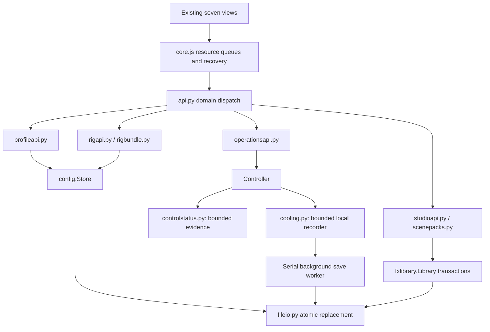

# Airglow audit roadmap implementation

Implemented locally on 2 November 2026 in `release/1.11.1`, following the approved [deep-dive audit](AUDIT-2026-11-02-DEEP-DIVE.md), [design](superpowers/specs/2026-11-02-audit-roadmap-design.md) and [plan](superpowers/plans/2026-11-02-audit-roadmap.md). All four proposed product MVPs and the engineering/UX recommendations are now functional in the existing application. The earlier ten audit fix groups and pre-existing checkout work remain present.

This report records the original local implementation and its verification. Release 1.12.0 carries these changes on top of the separately released 1.11.2 fixes. Local analytics and media work are excluded from the release; the review artifacts linked below remain in the original review checkout. No installed application or physical hardware was changed during implementation or release preparation.

## What you can use

| Surface | New workflow |
| --- | --- |
| **Overview → Control center** | Inspect controller cycles, sensor samples, lighting completion, device ownership, pending/failed/stale/disconnected states and recent events. Recheck sensors, reconnect discovery or resend lighting explicitly. **Customize → Add a tile → Control status** adds the optional summary tile. |
| **Fans → Cooling workbench** | Name a workload, start/stop recording, compare two sessions, replay draft curve targets, export JSON/CSV and delete recordings. Graphs show temperature, curve commands and measured RPM over elapsed time. Recording, comparison and replay never apply fan settings. |
| **Lighting → Save profile** | Apply a profile, adjust its lighting, then choose **Update this profile** or **Save as new**. Updates preserve the ID referenced by automations. Lighting, area/zone overrides and fan inclusion are explicit. |
| **Settings → Rig migration** | Export a local JSON bundle. Import through validation, a preview, an explicit target or Skip for every source zone, then Apply reviewed import. Profiles/curves/rules receive collision-safe IDs; imported automations start disabled. |
| **Studio** | Follow the starting-effect → palette/macros/layers → Save → optional Apply workflow. Reuse favorite palettes, reveal publishing/control-exposure details when needed, and see confirmed preview/applied state. Export/import scene packs with effect sources, named areas and optional controls. |
| **Fan channel → Copy settings to…** | Choose named targets. Fans start selected; pumps require explicit selection. Partial success identifies failed targets and leaves them available for retry. |
| **Shared controls** | Persistent save failures with explicit recovery, resource-serialized writes, keyboard Add curve point, stable automation/Studio focus, compact narrow Fans telemetry and a visible seven-section navigation selector. |

Scene-pack assignments remain a portable setup guide. Import installs effects without changing the current scene; Preview effect opens the editor, and Use on my lights is a separate explicit action. Custom effects retain the existing validation and sandbox.

When a profile-owned curve is already selected manually, removing that curve from an updated profile preserves it as an independent named curve in the same save transaction. A currently active fan automation must be paused before its referenced fan assignment is changed or removed. Equivalent fan settings still allow a lighting update. These rules prevent Save from silently changing cooling output.

## Structure and ownership

- [controlstatus.py](../airglow/controlstatus.py) owns bounded completed-work evidence and event transitions. Controller, sensor polling and device writers report actual completion independently of queued requests. Retired writers cannot publish successful work for a replacement device.
- [cooling.py](../airglow/cooling.py) owns bounded recordings, history validation, comparison, draft replay and exports. Serialization and disk I/O run on a bounded serial worker outside the controller path and recorder memory lock. Shutdown performs fan safety/release before a bounded save drain.
- [profileapi.py](../airglow/profileapi.py), [rigbundle.py](../airglow/rigbundle.py) and [rigapi.py](../airglow/rigapi.py) isolate profile and migration contracts. Store compound operations validate candidates, persist them and then publish memory, restoring original bytes on ordinary later-write failures.
- [fileio.py](../airglow/fileio.py) centralizes same-directory unique temporary files, flush/fsync, replacement, bounded Windows permission retries and cleanup. Protected unread files remain protected.
- Studio responsibilities now live in [studio-document.js](../web/js/studio-document.js), [studio-preview.js](../web/js/studio-preview.js), [studio-gallery.js](../web/js/studio-gallery.js) and [studio-packs.js](../web/js/studio-packs.js); [studio.js](../web/js/studio.js) retains editor rendering/interaction. [scenepacks.py](../airglow/scenepacks.py) validates portable content without receiving a controller.

## Recommendation coverage

| Audit recommendation | Implementation and evidence |
| --- | --- |
| Explicit mutation ownership and recovery | Resource queues snapshot bodies and serialize conflicting writes. Failed idempotent saves can be retried; newer writes, including silent Studio previews, invalidate obsolete recovery. Non-idempotent imports/creation are not automatically replayed. Controller/Store publish after successful persistence. Covered by UI race/state, controller, profile and migration tests. |
| Progress rather than thread existence | Monotonic completion ages, durations and epoch timestamps for controller/sensors/output; ownership and recovery events; bounded stale detection also covers indefinitely pending or never-completed work. Control-status and sensor tests plus browser Control center flow. |
| Testable device ownership/reconnect | Event-controlled writer retirement, queued-write discard, failed flush and replacement tests. Existing disable/blackout regressions retained. Physical serialless identity matching remains an explicit hardware-evidence limit below. |
| Shared file-write mechanics | Shared atomic utility; exact original-byte rollback for compound saves/imports; protected source/target handling. File I/O, config, effect-library, profile and rig tests. |
| Split large modules | Profile/rig/operations/scene-pack route families and Studio document/preview/gallery/pack modules. All 34 browser modules resolve and Windows entry-point imports pass. |
| Browser regressions as CI gate | Windows browser job installs pinned Playwright/Chromium, starts an isolated simulated rig, runs existing visual/responsive tests plus new workflows, and uploads logs/screenshots. Build depends on the test and browser jobs. |
| Reduce CSS ambiguity | Shared spacing/control-height tokens, removal of duplicate eyebrow/caption styling and conflicting legacy narrow Studio rules. Preserve the existing twelve themes and layout persistence semantics. |
| Profile update/new and scope | Stable-ID update, retained update target after adjustment, explicit area/fan inclusion, active-curve preservation and failed-save rollback. Unit and browser tests. |
| Explicit fan/pump targets | Named selections, pump opt-in, captured source settings and accurate partial results. JS and browser tests. |
| Stable keyboard editing | Automation value edits preserve the field; day controls retain focus. Studio rerenders restore focus/caret/disclosures. Add curve point inserts and focuses a draft point without applying it. JS and browser tests. |
| Persistent Studio state | Uses the enabled effective scene and trial state; automation/lock overrides cannot falsely claim live output. Delayed start/cleanup tests and browser Save versus Apply flow. |
| Earlier narrow cooling controls | Compact telemetry cards, with the curve visible in a 390px window. Rendered capture and existing fan-control checks. |
| Visible narrow navigation | Native selector exposes all seven views; desktop tabs and shortcuts remain. Browser navigation and existing visual suite. |
| Progressive Studio details | Palette/macros lead; favorite palettes, control exposure and publishing metadata use disclosures. Layer menus and code/layer panes verified at 390px and 700px. |
| Persistent recovery messages | Global resource failure banner plus local Studio/profile/import/workbench errors; explicit retries preserve drafts and import intent. Delayed replies cannot reopen dismissed import sheets or replace a newer editor. |
| Product 1: dependable control center | Optional Overview tile, full status/ownership sheet, bounded event timeline and explicit recovery requests. |
| Product 2: cooling workbench | Opt-in recording, workload annotation, chronological plots, two-session comparison, draft replay and JSON/CSV downloads. |
| Product 3: creator instrument | Guided remix, existing macros, favorite palettes and portable scene packs with reviewed conflict choices. Community copies retain revocation tracking after reopening; concurrent stale imports are rejected under the library transaction. |
| Product 4: rig migration kit | Portable bundle, explicit hardware mapping/skip, capability validation, ID/reference remapping, disabled imported rules and rollback. Second-rig Python tests plus browser export/import flow. |

## Review corrections

Independent runtime, migration, Studio and shared-UI reviews reproduced problems before acceptance. Corrections include recording disk I/O blocking fan cycles; inactive curve duty appearing as commanded output; malformed history; pending writes masking staleness; removal of active profile curves; obsolete import callbacks; community-copy revocations; concurrent import freshness; effective-output labels; portable-file size parity; obsolete lighting retry; and automation recovery losing the restored list.

Rendered review also exposed a narrow Studio menu overlapping the preview because legacy CSS capped the layer pane. The conflicting rules were removed and a geometry regression now checks preview/pane ordering and menu containment.

## Verification

The clean 1.12.0 release checkout is based on 1.11.2 and excludes unrelated analytics/media work. Its suite includes **667 Python tests, 83 JavaScript tests, 11 browser workflows, 135 visual checks, responsive Overview checks, and 56 validation commands**. The standalone browser suite now waits for simulated fan discovery. Its Studio fault injection uses a context route and asserts the injected HTTP 500 before checking the error message, so delayed page-route cleanup cannot silently turn the failure scenario into a successful save.

The first GitHub CI run also exposed a theme-chooser focus race: its delayed initial focus could override keyboard navigation. Two deterministic regressions reproduced the problem; the chooser now focuses the selected design immediately after opening the modal. The release tag is gated on the corrected CI run.

Original implementation-checkout results (including the already-present analytics tests):

| Check | Result |
| --- | --- |
| Python suite | **691 passed** in 28.320 s. Includes injected disk/network faults, gated writes and controller snapshot races. |
| JavaScript behavior suites | **88 passed**. Actual modules, deferred requests, history, recovery, queues, effect runtime and import workflows. |
| New browser workflows | **11 passed**, including keyboard/focus, profile identity, retry, fan targets, control tile persistence, recording/compare/replay/download, rig migration, Studio save/live/apply, delayed imports and narrow Paper-theme code editing. |
| Existing visual suite | **135 checks passed**, zero failures and zero page errors; twelve themes and representative views/sizes. |
| Responsive Overview suite | Passed through phone, portrait, ultrawide and 4K, including persisted-layout editing. |
| Module/content validation | **56 commands passed**: Python compilation and Windows entry-point imports; 34 browser modules; JS syntax; 7 effects; 4 gallery profiles; 2 device plugins; whitespace checks. |
| Fixture lifecycle | Owned server stopped in `finally`; [results.json](../output/implementation-2026-11-02/final-browser/results.json) records all three browser suites passing and `fixture_stopped: true`. |

Representative wide/narrow Control center, Fans, migration and Studio captures were visually inspected in Graphite and Paper. Existing theme captures supplement these checks. Browser checks use reduced motion; this is not motion-quality or real hardware approval. The new GitHub Actions job is configured and its local commands passed; it has not been run remotely in this unpushed checkout.

The initial design detector reported six warnings and two advisories through index.html. Source review confirmed the warnings describe existing short-label/brand tracking, the hardware-identification cue and lighting-effect thumbnails; the thumbnails are paused until hover or keyboard focus. Four rule/value exceptions were saved, scoped only to index.html, alongside the existing dark-glow exception for control-state accents. The detector then exited 0 with two non-blocking stripe/grid theme advisories still visible. The detector remains enabled; no application styling changed during this triage.

## Bounds and remaining external validation

- Control evidence keeps at most **200 events / 128 output identities**. A completed software write/flush is not independent measurement of physical LED or fan response.
- Cooling keeps at most **1,800 samples per recording / 12 recordings**, at the existing two-second cadence, with a 64 MiB history-file cap. Missing readings remain missing. Curve commands are absent when no output follows the curve; per-channel targets remain in the recording. RPM is not an acoustic measurement, and draft replay does not predict thermal response.
- Abrupt process/power loss can recover only the latest durable active marker/checkpoint. Unsaved samples may be lost; recovery says so. Ordinary save failure retains data in memory for explicit retry. Graceful shutdown drains saves for at most one second after releasing hardware.
- Rig bundles are bounded to **192 KiB**; scene packs to **240 KiB / 12 effects**, with the existing per-effect **32,000-byte** limit. Both validate before installation. Scene-pack export also checks the actual browser UTF-8 download size.
- Multi-file rollback handles ordinary exceptions. It does **not** promise atomicity across process/power loss. No fan/pump ownership, helper paths, startup side effects or credentials are transferred by rig import.
- Serialless NZXT device identity still requires representative physical HID enumeration before changing matching. Real reconnect/firmware, sleep/resume, worst-case physical output latency, thermal/acoustic behavior and a clean-PC installer are not qualified by the fixture. No physical settings were used for these tests.

## Reviewable artifacts

- [Only this implementation's source changes](../output/implementation-2026-11-02/implementation-only.diff), compared with the saved starting source rather than Git HEAD.
- [Changed-file manifest](../output/implementation-2026-11-02/changed-files.json), baseline hashes/source archive and review reports in the [evidence folder](../output/implementation-2026-11-02/).
- [Python log](../output/implementation-2026-11-02/python-final.log), [JavaScript log](../output/implementation-2026-11-02/javascript-final.log), [validation log](../output/implementation-2026-11-02/validation-final.log) and [browser evidence](../output/implementation-2026-11-02/final-browser/).

To rerun the browser gate locally, use `python tools/run-ui-checks.py --output output/browser-checks`. It refuses occupied fixture ports 8790/8791 and never attaches to the installed app on 8787.
